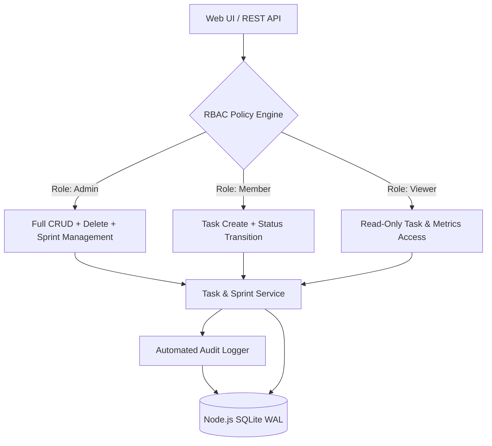

# TaskForge — Enterprise Kanban & Sprint SaaS

**Author:** Alvin MS ([@Soulofghost](https://github.com/Soulofghost))  
**Domain:** Full-Stack SaaS & Project Governance  
**Tier:** ⭐ Flagship Portfolio Project  
**Status:** Verified & Production-Ready  

---

## 1. Project Introduction

**TaskForge** is an enterprise project management and sprint orchestration platform engineered for high-velocity software engineering organizations. Designed with a strict Role-Based Access Control (RBAC) security model (`admin`, `member`, `viewer`), TaskForge combines interactive multi-column Kanban workflows, story point burndown metrics, and a tamper-evident audit trail logging every status change and assignee mutation.

---

## 2. Problem Statement

Engineering teams frequently grapple with uncoordinated project tracking tools:
- Fragmented sprint tracking tools obscure real-time velocity and milestone completion percentages.
- Permissive access controls allow unauthorized contributors to alter task scopes, reassign priorities, or delete critical backlog items.
- Absence of chronological audit logs makes it impossible to trace who modified task requirements or moved items to completion.
- Heavy SaaS project management tools suffer from slow load times and excessive configuration complexity.

---

## 3. Proposed Solution

TaskForge provides an agile, zero-bloat project management platform:
- **Granular RBAC Permission Matrix:** Enforces strict authorization policies across HTTP endpoints. Viewers cannot mutate state; members can create and advance tasks; only administrators can delete entities.
- **Automated Lifecycle Audit Logging:** Every task creation, status transition (`backlog` -> `in_progress` -> `review` -> `done`), and priority alteration records an immutable audit log.
- **Sprint Burndown Telemetry:** Automatically calculates story point completion rates and velocity progress against active sprint deadlines.
- **Linear/Jira-Inspired Interface:** High-contrast carbon layout with live story point pill tags, assignee indicators, and a collapsible security audit drawer.

---

## 4. Key Features

- **Interactive 4-Stage Kanban:** Structured swimlanes with one-click status advancement and active task counters.
- **Sprint Velocity Tracker:** Real-time completion progress bar tracking resolved story points against sprint commitments.
- **Role Simulation Matrix:** Switch between `Admin`, `Member`, and `Viewer` profiles to audit authorization boundaries live.
- **Comprehensive Audit Trail Drawer:** Chronological drawer displaying actor attribution, changed fields, old vs new values, and timestamps.
- **Native ACID Persistence:** Utilizes Node.js native SQLite engine in WAL mode for zero external database server overhead.

---

## 5. Architecture Diagram



---

## 6. Technology Stack

- **Runtime:** Node.js v22+
- **Persistence:** Built-in `node:sqlite` (ACID transactions, Write-Ahead Logging)
- **Security:** Granular RBAC Permission Matrix Middleware
- **Frontend:** Vanilla JavaScript, Modern CSS (`Plus Jakarta Sans` & `JetBrains Mono`)
- **Testing:** Built-in `node:test` and `node:assert`
- **Containerization & CI:** Docker, Docker Compose, GitHub Actions

---

## 7. Folder Structure

```
taskforge/
├── backend/
│   ├── src/
│   │   ├── config.js         # Port and persistence file paths
│   │   ├── db.js             # SQLite schema, tables, and initial seed sprint
│   │   ├── rbac.js           # Role permission matrix & authorization guards
│   │   ├── taskService.js    # Task lifecycle, metrics & audit logging logic
│   │   └── server.js         # HTTP REST API server & static file host
│   ├── tests/
│   │   ├── rbac.test.js      # Role boundary unit tests
│   │   └── task.test.js      # Task lifecycle & burndown integration tests
│   └── package.json          # Project manifest and test runner
├── frontend/
│   ├── index.html            # Kanban board & sprint dashboard layout
│   ├── style.css             # High-contrast carbon & slate design system
│   └── app.js                # State manager, role simulator & audit controller
├── .github/workflows/ci.yml  # Automated GitHub Actions test workflow
├── .env.example              # Environment configuration defaults
├── .gitignore                # Node and database ignore rules
├── Dockerfile                # Production container image
├── docker-compose.yml        # Docker composition manifest
├── LICENSE                   # SPDX MIT declaration
└── README.md                 # Complete technical documentation
```

---

## 8. Installation Instructions

### Prerequisites
- Node.js v22.0.0 or higher
- Git

### Setup Steps
```bash
# Clone repository
git clone https://github.com/Soulofghost/taskforge.git
cd taskforge

# Run server
node backend/src/server.js
```
Open `http://localhost:8004` in your browser.

---

## 9. Environment Configuration

Copy `.env.example` to `.env`:
```ini
PORT=8004
NODE_ENV=development
DB_PATH=backend/data/taskforge.db
```

---

## 10. Database Setup

Database initialization is automatic on launch via `getDb()` in `db.js`. It creates `users`, `sprints`, `tasks`, and `audit_logs` tables and seeds initial users and sprint tasks.

---

## 11. API Documentation

| Method | Endpoint | Description |
|---|---|---|
| `GET` | `/api/v1/health` | Health status and database engine mode |
| `GET` | `/api/v1/users` | List users and their assigned roles |
| `GET` | `/api/v1/sprints` | List sprints |
| `GET` | `/api/v1/sprints/:id/metrics` | Calculate sprint story point completion and velocity |
| `GET` | `/api/v1/tasks?sprint_id={id}` | List tasks for a given sprint |
| `POST` | `/api/v1/tasks` | Create task (enforces `task:create` role permission) |
| `GET` | `/api/v1/tasks/:id` | Fetch task detail with connected audit history |
| `PATCH` | `/api/v1/tasks/:id/status` | Advance task status (records audit event) |
| `DELETE` | `/api/v1/tasks/:id` | Delete task (restricted to `admin` role) |
| `GET` | `/api/v1/audit?limit={limit}` | Fetch chronological system audit log |

---

## 12. UI Walkthrough

The interface provides an enterprise agile workspace:
1. **Header:** Displays sprint name, real-time velocity progress bar, role simulation dropdown (`Admin`, `Member`, `Viewer`), and task creation trigger.
2. **Kanban Board:** 4 swimlanes (`Backlog`, `In Progress`, `Review`, `Done`) featuring priority badges, story points, and 1-click status advancement.
3. **Audit Drawer:** Slide-out drawer tracking every state mutation, assignee modification, and priority change with actor name and timestamp.

---

## 13. Testing Instructions

TaskForge uses Node's native test runner for fast, zero-dependency test verification:

```bash
cd backend
npm test
```

---

## 14. Security Considerations

- **Strict RBAC Enforcement:** Every state mutation verifies the actor's role against the permission matrix before executing.
- **Audit Logging Immutability:** Audit records are write-only and cannot be altered or removed through user APIs.
- **SQL Injection Prevention:** All queries execute via SQLite prepared statements.

---

## 15. Deployment Instructions

### Docker Deployment
```bash
docker compose up -d --build
```
Access the application at `http://localhost:8004`.

---

## 16. Known Limitations

- Multi-tenancy currently operates on a single organization database.
- WebSockets can be added for live multi-user cursor tracking.

---

## 17. Future Roadmap

- [ ] Interactive Gantt chart timeline view.
- [ ] GitHub webhook integration to automatically move tasks on pull request merges.
- [ ] Export sprint retro summaries to PDF and Markdown.

---

## 18. License

Distributed under the MIT License. See `LICENSE` for details.
